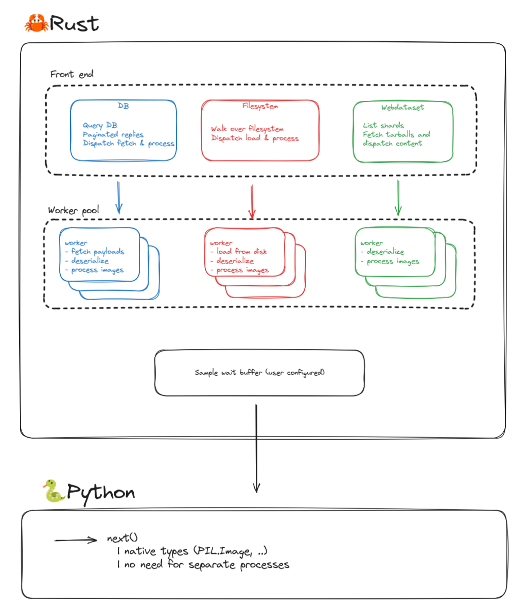
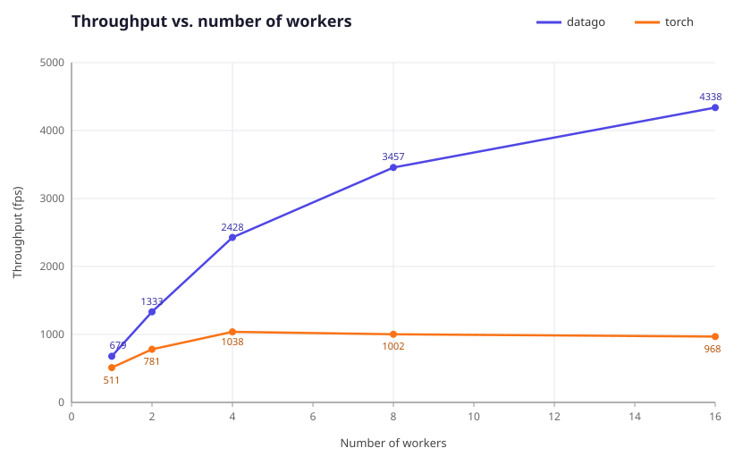
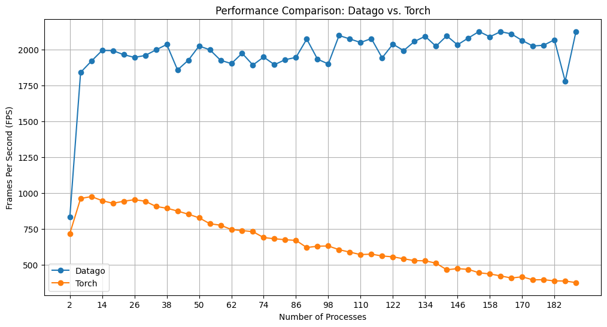
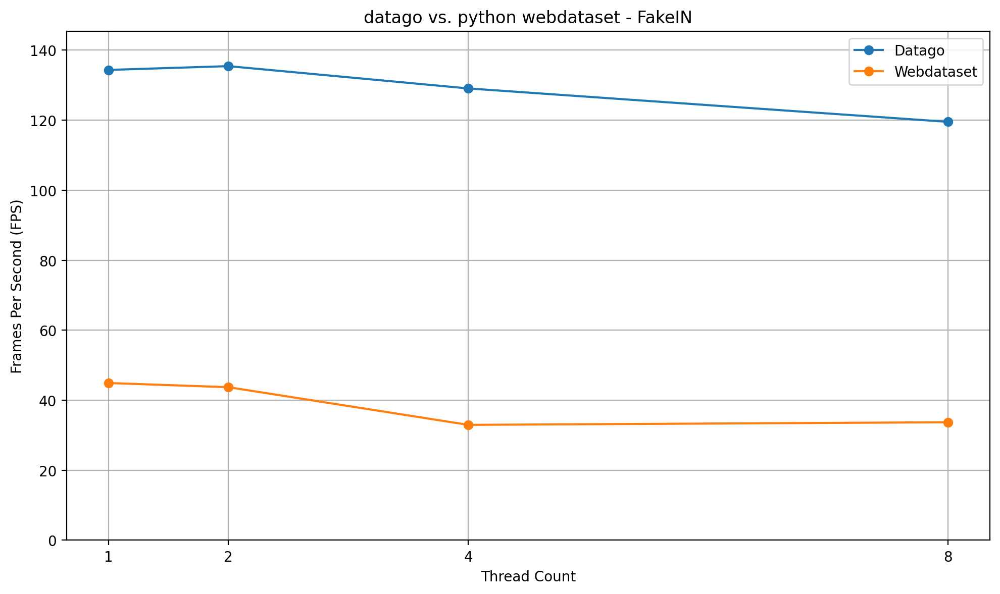
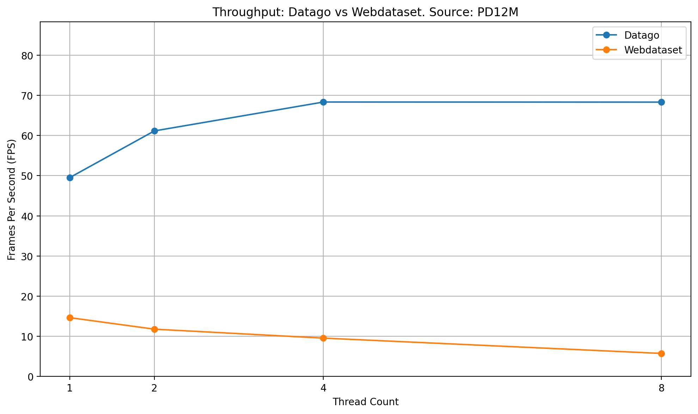
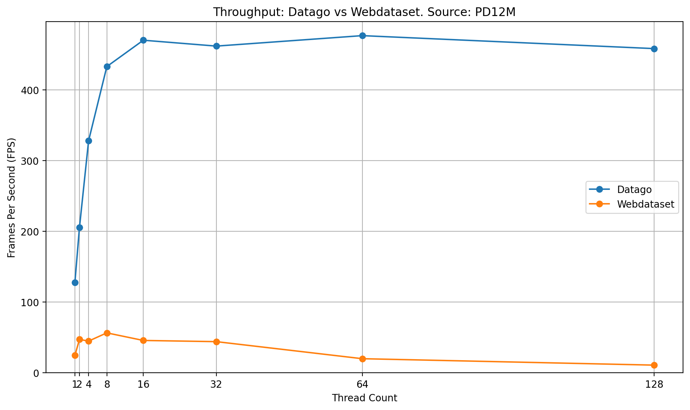
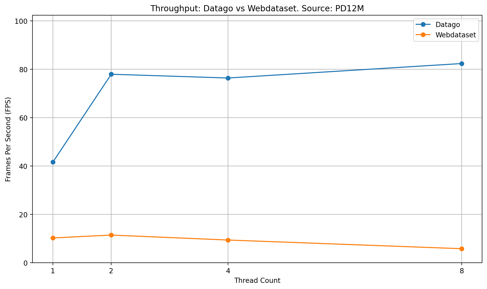

# datago

[](https://github.com/Photoroom/datago/actions/workflows/rust.yml)
[](https://github.com/Photoroom/datago/actions/workflows/ci-cd.yml)

A Rust-written data loader which can be used as a python module. Handles several data sources, from local files to webdataset or a VectorDB focused http stack like our open sourced [dataroom](https://github.com/Photoroom/dataroom). Focused on image data at the moment, could also easily be more generic.

Datago handles, outside of the Python GIL

- per sample IO
- deserialization (jpg and png decompression)
- some optional vision processing (aligning different image payloads)
- optional serialization

Images can be returned as PIL objects or read-only NumPy views over shared Rust
storage. File, HTTP, and WebDataset sources support bounded buffering, cancellation,
and distributed loading through source-specific rank/world-size settings.



<details> <summary><strong>Use it</strong></summary>

You can simply install datago with `[uv] pip install datago`

## Use the package from Python
Please note that in all the of the following cases, you can directly get an IterableDataset (torch compatible) with the following code snippet

```python
from dataset import DatagoIterDataset

client_config = {
    "source_type": "file",
    "source_config": {"root_path": "/path/to/images"},
    "limit": 2000,
    "samples_buffer_size": 256,
    "image_format": "numpy",  # Omit for PIL output.
}
datago_dataset = DatagoIterDataset(client_config, return_python_types=True)
```

With `return_python_types=True`, samples are dictionaries whose images follow the
configured `image_format`.

### Image output

| API / setting | Result |
| --- | --- |
| `client.get_sample()` | Sample and image wrappers with metadata and explicit conversion methods |
| `client.get_sample_auto_convert()`, `"image_format": "pil"` (default) | Dictionary containing PIL images |
| `client.get_sample_auto_convert()`, `"image_format": "numpy"` | Dictionary containing NumPy arrays for images, masks, and additional images |

Set `"image_format": "numpy"` in the client configuration to avoid materializing
PIL images. Raw arrays are read-only views over shared Rust pixels and remain valid
after the sample or client is dropped. Use `array.copy()` for writable storage.
Single-channel arrays have shape `(H, W)`; multi-channel arrays use `(H, W, C)`.
Their dtype preserves the source: `uint8`, `uint16`, or `float32`.

`sample.image.to_numpy_array()` and `sample.image.to_pil_image()` also convert
individual images. PIL supports 16-bit grayscale, but wider multi-channel images
raise `ValueError`; use NumPy to preserve their precision. Invalid pixel layouts
and unsupported conversions propagate ordinary Python exceptions.

Cloning a sample or calling `get_payload()` shares its immutable pixels. Reading
`payload.data` returns an owned byte copy; assigning to it replaces that wrapper's
storage without invalidating existing views. Raw metadata properties (`width`,
`height`, `size`, `mode`, `palette`) avoid constructing a PIL image.

With `pre_encode_images=True`, the buffer protocol exposes compressed bytes.
Use `to_numpy_array()` or `to_pil_image()` to decode them. Decoding runs natively
outside the GIL and preserves channels and precision; decoded output requires a
new allocation rather than a view over the compressed stream.

### Lifecycle and cancellation

Python sample reads try the ready queue without releasing the GIL, then release it
while waiting and poll Python signals every 100 ms. Python delivers SIGINT handlers
on the main thread only. If a reader runs in a background thread, handle Ctrl-C on
the main thread by calling `client.stop()`; that cancellation is safe while the
reader is waiting. `stop()` closes both pipeline queues, releases the GIL while
joining, and returns after a short grace period if native work is still in flight.
Remaining thread handles are retained by a cleanup reaper rather than detached.
Prefer `try/finally` with `client.stop()` for explicit cleanup. Cancellation remains
active after metadata ends and while the output queue is full. Async downloads and
queued work are cancelled; already-running blocking IO or computation may continue
in the background until the native operation returns. The native Rust client
retains its blocking API. Reads do not silently restart: once the stream is
exhausted (or `stop()` has been called) `get_sample()` returns `None`, and you must
call `start()` again to begin a new pass.

Waiting on an empty queue also lets other Python threads run. For very cheap
samples, GIL contention can reduce throughput compared with a reader that keeps
the GIL; queued samples still use the fast path without releasing it.
`live_cleanup_threads()` counts cleanup reapers, not all native threads or
blocking-pool tasks that outlive runtime shutdown.

Workers count successfully published samples: `limit` is an upper bound on delivery,
including under concurrency. Unreadable items do not consume that budget, although
a finite source may end before reaching the limit. In-flight tasks are also capped
by the remaining delivery budget, so a small limit does not start a full worker pool.
WebDataset samples require a readable reference image (`reference_image_type`);
missing or corrupt references are skipped. Additional images use the reference
image's target aspect ratio, regardless of their order in the archive.

### Read results and errors

| Outcome | Rust (`try_get_sample`) | Python (`get_sample` / `get_sample_auto_convert`) |
|---|---|---|
| Sample available | `Ok(Some(sample))` | Return the sample |
| Normal exhaustion or explicit stop | `Ok(None)` | Return `None` |
| Fatal source or worker failure | `Err(DatagoError::Source(_))` / `Err(DatagoError::Worker(_))` | Raise `RuntimeError` |
| Read timeout | `Err(DatagoError::Timeout)` | Raise `TimeoutError` |
| Invalid configuration or timeout argument | `Err(DatagoError::Configuration(_))` | Raise `ValueError` |

Unreadable individual images are logged and skipped. Failures to enumerate the
source, fetch/parse metadata pages, download shards, or execute a worker end the
pass with an error. A fatal failure cancels outstanding work and discards queued
samples. Concurrent stop and failure use the first recorded terminal outcome.
After a fatal source/worker error or timeout, subsequent reads return `None`; call `start()` explicitly
to begin a new pass. Errors belong to their engine generation and cannot stop a
restarted pass.

Python reads accept a keyword-only `timeout` in seconds (default: 300). Rust callers
can use `try_get_sample_timeout(Duration)` for a per-read timeout. Zero checks the
ready queue without waiting. Cleanup gets a short grace period; stalled native
operations may finish under a background reaper. Python `KeyboardInterrupt` remains
an interrupt rather than a pipeline error.

```python
try:
    while (sample := client.get_sample(timeout=30.0)) is not None:
        process(sample)
finally:
    client.stop()
```

The existing Rust `get_sample()` remains a compatibility wrapper: it logs failures
and returns `None`. Use `try_get_sample()` when failure must be distinguished from
normal exhaustion. Python propagates failures through its existing read methods.

### Release notes: 2026.10.1

- **Breaking change:** reads after end-of-stream or `stop()` return `None` rather
  than silently starting another epoch. Call `start()` explicitly for each new pass.
- DB processing now defaults to `min(CPU count, connection budget, sample limit)`
  in-flight tasks, rather than accidentally serializing when `DATAGO_MAX_TASKS` is
  unset. WDS processing defaults to one task per CPU. `DATAGO_MAX_TASKS=0` retains
  serial processing; explicit overrides retain their existing source-specific caps.
- Python waits release the GIL and check signals; cancellation also covers DB page
  requests and WDS shard listing/downloads. Already-running blocking filesystem
  calls may still outlive shutdown.
- Source builds require `maturin>=1.9.4,<2`. Release builds no longer use
  `panic = "abort"`, allowing worker panics to be reported instead of aborting
  the process.

<details> <summary><strong>Dataroom</strong></summary>

```python
from datago import DatagoClient, initialize_logging
import os
import json

# Respects RUST_LOG=INFO env var for setting log level
# If omitted the logger will be initialized when the client starts.
initialize_logging()

config = {
    "source_config": {
        "sources": os.environ.get("DATAROOM_TEST_SOURCE", ""),
        "page_size": 500,
        "rank": 0,
        "world_size": 1,
    },
    "limit": 200,
    "samples_buffer_size": 32,
}

client = DatagoClient(json.dumps(config))

for _ in range(10):
    sample = client.get_sample()
```

`get_sample()` returns wrappers with explicit image conversion methods; see
[Image output](#image-output).

</details><details> <summary><strong>Local files</strong></summary>

To test datago while serving local files (jpg, png, ..), code would look like the following.
**Note that datago serving files with a lot of concurrent threads means that, even if random_sampling is not set,
there will be some randomness in the sample ordering.**

```python
from datago import DatagoClient, initialize_logging
import os
import json

# Can also set the log level directly instead of using RUST_LOG env var
initialize_logging(log_level="warn")

config = {
    "source_type": "file",
    "source_config": {
        "root_path": "myPath",
        "random_sampling": False,  # True if used directly for training
        "rank": 0,  # Optional, distributed workloads are possible
        "world_size": 1,
    },
    "limit": 200,
    "samples_buffer_size": 32,
}

client = DatagoClient(json.dumps(config))

for _ in range(10):
    sample = client.get_sample()
```

</details><details> <summary><strong>[experimental] Webdataset</strong></summary>

Please note that this implementation is very new, and probably has significant limitations still. It has not yet been tested at scale.
Please also note that you can find a better example in /python/benchmark_webdataset.py, which will show how to convert everything to more pythonic types (PIL images).

```python
from datago import DatagoClient, initialize_logging
import os
import json

# Can also set the log level directly instead of using RUST_LOG env var
initialize_logging(log_level="warn")

# URL of the test bucket
bucket = "https://storage.googleapis.com/webdataset/fake-imagenet"
dataset = "/imagenet-train-{000000..001281}.tar"
url = bucket + dataset

client_config = {
    "source_type": "webdataset",
    "source_config": {
        "url": url,
        "random_sampling": False,
        "concurrent_downloads": 8,  # The number of TarballSamples which should be handled concurrently
        "rank": 0,
        "world_size": 1,
    },
    "prefetch_buffer_size": 128,
    "samples_buffer_size": 64,
    "limit": 1_000_000,  # Dummy example, max number of samples you would like to serve
}

client = DatagoClient(json.dumps(client_config))

for _ in range(10):
    sample = client.get_sample()
```

</details>

## Process images on the fly

Datago can also process images on the fly, for instance to align different image payloads. This is done by adding an `image_config` to the configuration. The following example shows how to align different image payloads.

Processing can be very CPU heavy, but it will be distributed over all CPU cores wihout requiring multiple python processes. I.e., you can keep a single python process using `get_sample()` on the client and still saturate all CPU cores.

There are three main processing topics that you can choose from:

- crop the images to within an aspect ratio bucket (which is very handy for all Transformer / patch based architectures)
- resize the images (setting here will be related to the square aspect ratio bucket, other buckets will differ of course)
- pre-encode the images to a specific format (jpg, png, ...)

```python
config = {
    "source_type": "file",
    "source_config": {
        "root_path": "myPath",
        "random_sampling": False,  # True if used directly for training
    },
    # Optional pre-processing of the images, placing them in an aspect ratio bucket to preserve as much as possible of the original content
    "image_config": {
        "crop_and_resize": True,  # False to turn it off, or just omit this part of the config
        "default_image_size": 1024,
        "downsampling_ratio": 32,
        "min_aspect_ratio": 0.5,
        "max_aspect_ratio": 2.0,
        "pre_encode_images": False,
    },
    "limit": 200,
    "samples_buffer_size": 32,
}
```

## Match the raw exported buffers with typical python types

Use `sample.image.to_numpy_array()` or `sample.image.to_pil_image()` for a single
image, or `client.get_sample_auto_convert()` for a complete dictionary. See
[Image output](#image-output) for storage, dtype, and lifetime guarantees.

## Logging

We are using the [log](https://docs.rs/log/latest/log/) crate with [env_logger](https://docs.rs/env_logger/latest/env_logger/).
You can set the log level using the RUST_LOG environment variable. E.g. `RUST_LOG=INFO`.

When using the library from Python, `env_logger` will be initialized automatically when creating a `DatagoClient`. There is also a `initialize_logging` function in the `datago` module, which if called before using a client, allows to customize the log level. This only works if RUST_LOG is not set.

## Env variables

There are a couple of env variables which will change the behavior of the library, for settings which felt too low level to be exposed in the config.

- `DATAGO_MAX_TASKS`: maximum in-flight processing tasks, not native thread count.
  Defaults to CPU count for files/WDS and the smaller of CPU count and connection
  budget for DB sources, with source-specific caps. `0` means serial processing.
- `RUST_LOG`: see above, will change the level of logging for the whole library, could be useful for debugging or to report an issue here.
- `DATAGO_MAX_RETRIES`: number of retries for a failed sample load, defaults to 3.

</details><details> <summary><strong>Build it</strong></summary>

## Preamble

Just install the rust toolchain via rustup

## [Apple Silicon MacOS only]

If you are using an Apple Silicon Mac OS machine, create a `.cargo/config.toml` file and paste the following:

``` cfg
[target.x86_64-apple-darwin]
rustflags = [
  "-C", "link-arg=-undefined",
  "-C", "link-arg=dynamic_lookup",
]

[target.aarch64-apple-darwin]
rustflags = [
  "-C", "link-arg=-undefined",
  "-C", "link-arg=dynamic_lookup",
]
```

## Code organization

- `client.rs` owns the engine lifecycle, Python signal polling, and cleanup.
- `generator_*.rs` enumerate source metadata; `worker_*.rs` prepare individual samples.
- `worker_utils.rs` coordinates bounded concurrency, publication, sample limits, and cancellation.
- `image_payload.rs` owns shared pixels and validates their layout for image access.
- `python_buffer.rs` contains the buffer protocol boundary and its ownership invariants.
- `python_conversion.rs` converts samples into Python dictionaries and propagates errors.
- `config.rs` and `http_client.rs` contain configuration and connection policy.
- `structs.rs` holds pipeline data types and re-exports the original public type paths.

Tasks return prepared samples to the coordinator. Only the coordinator writes to
the output queue, so counting, cancellation, and end-of-stream behavior are shared
by all sources. Encoded bytes and raw pixel layouts are interpreted separately;
public payload fields remain compatible, with validation before pixel conversion.

## DB benchmark CLI

Run `cargo run --release -- -h` for the existing DB benchmark options.

## Run the rust test suite

From the datago folder

```bash
cargo test
```

## Generate the python package binaries manually

Build a wheel useable locally

```bash
maturin build -i python3.11 --release --target "x86_64-unknown-linux-gnu"
```

Build a wheel which can be uploaded to pypi or related

- either use a manylinux docker image

- or cross compile using zip

```bash
maturin build -i python3.11 --release --target "x86_64-unknown-linux-gnu" --manylinux 2014 --zig
```

then you can `pip install` from `target/wheels`

## Update the pypi release (maintainers)

Create a new tag and a new release in this repo, a new package will be pushed automatically.

</details>

<details> <summary><strong>Benchmarks</strong></summary>
As usual, benchmarks are a tricky game, and you shouldn't read too much into the following plots but do your own tests. Some python benchmark examples are provided in the [python](./python/) folder.

In general, Datago will be impactful if you want to load a lot of images very fast, but if you consume them as you go at a more leisury pace then it's not really needed. The more CPU work there is with the images and the higher quality they are, the more Datago will shine.

## Filesystem throughput: Python

The Python filesystem benchmark reports FPS, MP/s, MB/s, time to first sample,
and post-start FPS for Datago and optionally Torch. Its returned results and sweep
JSON include `pixels` and `megapixels_per_second`. Pixels count output spatial
positions (`width * height`), independent of channel count or bit depth.

Compare Python's raw stage with NumPy, PIL, and dictionary conversion to assess
conversion and object creation overhead:

```bash
# Python raw samples, then image and dictionary conversion.
uv run --group dev python/bench_stages.py --root-path /path/to/images --limit 2000 --workers 8 --stages raw,numpy,pil,convert

# Full Python NumPy output; remove --no-compare-torch to include Torch.
uv run --group dev python/benchmark_filesystem.py --root-path /path/to/images --limit 2000 --num-workers 8 --image-format numpy --no-compare-torch
```

Both accept `--crop-and-resize` for 1024 × 1024 output. Resized runs count
output pixels. They use a 256-sample buffer, include construction/startup in elapsed
time, exclude cleanup, and report an error if the source cannot supply the limit.
The full Python report uses `startup_seconds` for time to the first sample
and `steady_fps` for the rate after it (`null` for a single-sample run).

Use release builds for the extension, identical options
and an RGB8 corpus, and repeated runs with comparable filesystem cache state.
Raw versus converted Python output includes conversion and object creation.
Python progress reporting also adds work. `num_workers` controls Datago tasks and
Torch processes; native thread counts can differ.

## From disk: ImageNet

The following benchmarks are using ImageNet 1k, which is very low resolution and thus kind of a worst case scenario. Data is served from cache (i.e. the OS cache) and the images are not pre-processed. In this case the receiving python process is typically the bottleneck, and caps at around 3000 images per second.

### AMD Zen3 laptop - IN1k - disk - no processing


### AMD EPYC 9454 - IN1k - disk - no processing


One liner to repro locally (rebuilding the package):
```bash
DATAGO_TEST_FILESYSTEM=$PATH_TO_YOUR_TEST_DATA uv run --reinstall-package datago --python 3.14 --group dev python/benchmark_filesystem.py --sweep --limit 500
```

## Webdataset: FakeIN

This benchmark is using low resolution images. It's accessed through the webdataset front end, datago is compared with the popular python webdataset library. Note that datago will start streaming the images faster here (almost instantly !), which emphasizes throughput differences depending on how long you test it for.

Of note is also that this can be bottlenecked by your external bandwidth to the remote storage where WDS is hosted, in which case both solution would yield comparable numbers.

### AMD Zen3 laptop - webdataset - no processing



## Webdataset: PD12M

This benchmark is using high resolution images. It's accessed through the webdataset front end, datago is compared with the popular python webdataset library. Note that datago will start streaming the images faster here (almost instantly !), which emphasizes throughput differences depending on how long you test it for.

Of note is also that this can be bottlenecked by your external bandwidth to the remote storage where WDS is hosted, in which case both solution would yield comparable numbers.

### AMD Zen3 laptop - webdataset - no processing



### AMD EPYC 9454 - pd12m - webdataset - no processing



### AMD Zen3 laptop - webdataset - processing
Adding image processing (crop and resize to Transformer compatible size buckets) to the equation changes the picture, as the work spread becomes more important. If you're training a diffusion model or an image encoder from a diverse set of images, this is likely to be the most realistic micro-benchmark.



</details>


## License

MIT License

Copyright (c) 2025 Photoroom

Permission is hereby granted, free of charge, to any person obtaining a copy
of this software and associated documentation files (the "Software"), to deal
in the Software without restriction, including without limitation the rights
to use, copy, modify, merge, publish, distribute, sublicense, and/or sell
copies of the Software, and to permit persons to whom the Software is
furnished to do so, subject to the following conditions:

The above copyright notice and this permission notice shall be included in all
copies or substantial portions of the Software.

THE SOFTWARE IS PROVIDED "AS IS", WITHOUT WARRANTY OF ANY KIND, EXPRESS OR
IMPLIED, INCLUDING BUT NOT LIMITED TO THE WARRANTIES OF MERCHANTABILITY,
FITNESS FOR A PARTICULAR PURPOSE AND NONINFRINGEMENT. IN NO EVENT SHALL THE
AUTHORS OR COPYRIGHT HOLDERS BE LIABLE FOR ANY CLAIM, DAMAGES OR OTHER
LIABILITY, WHETHER IN AN ACTION OF CONTRACT, TORT OR OTHERWISE, ARISING FROM,
OUT OF OR IN CONNECTION WITH THE SOFTWARE OR THE USE OR OTHER DEALINGS IN THE
SOFTWARE.
